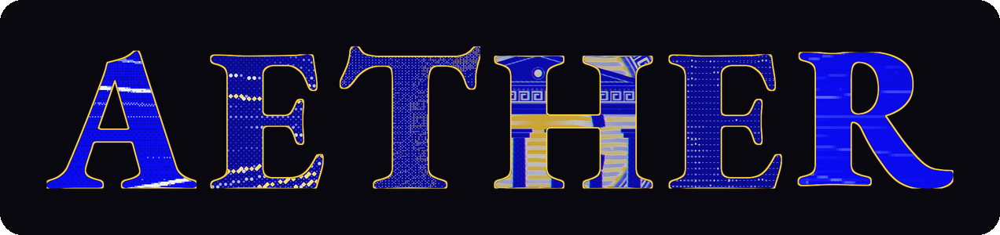
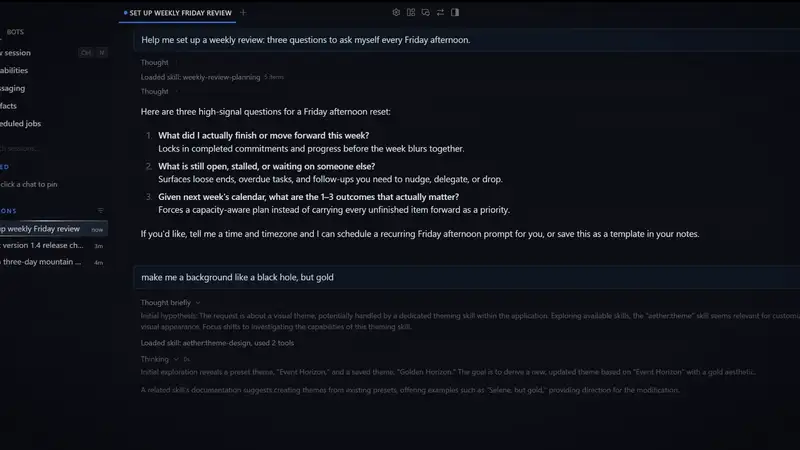
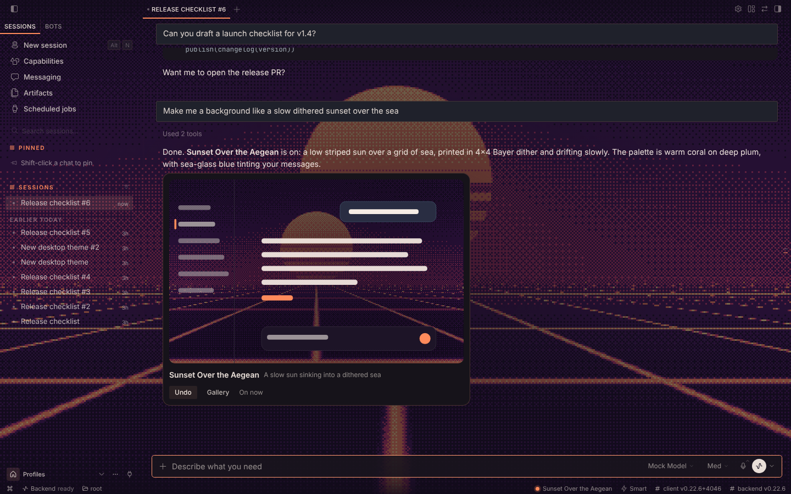
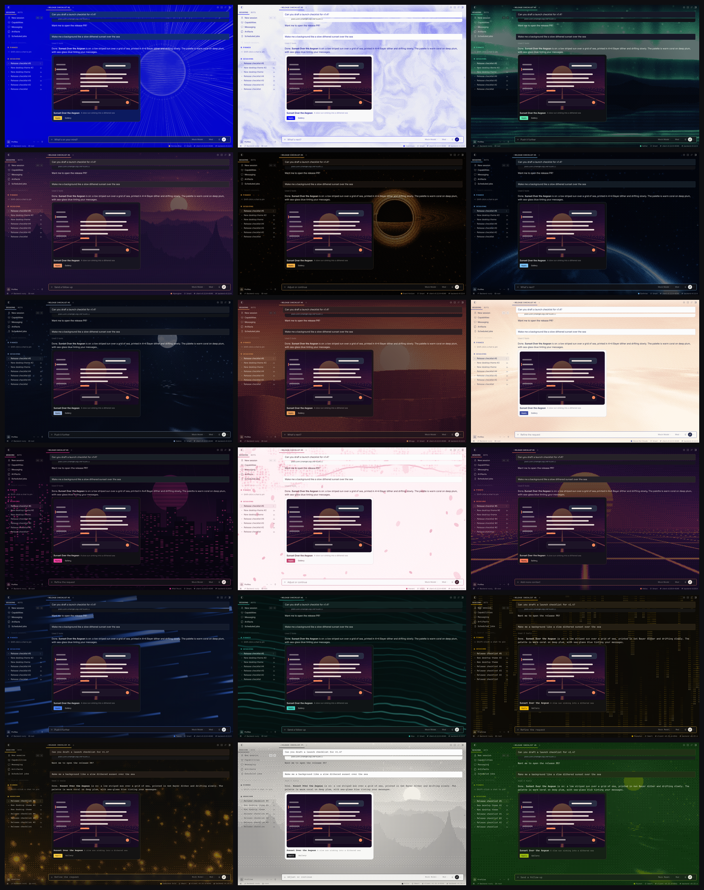
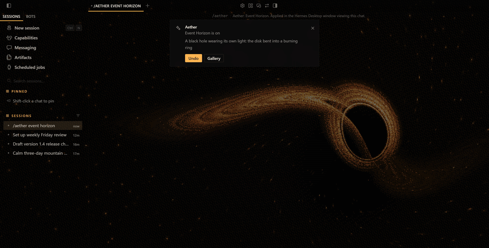
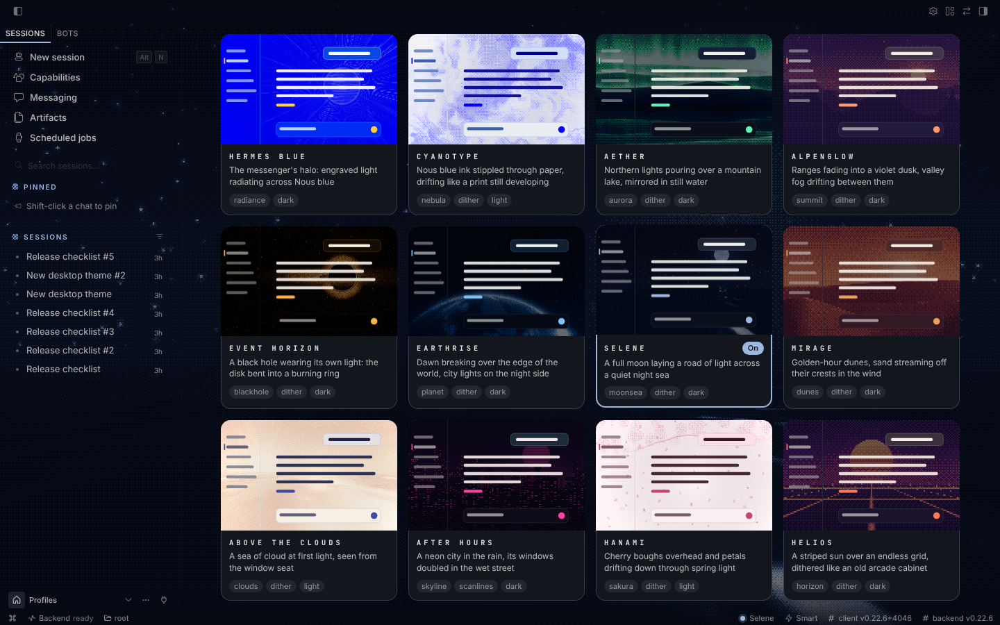
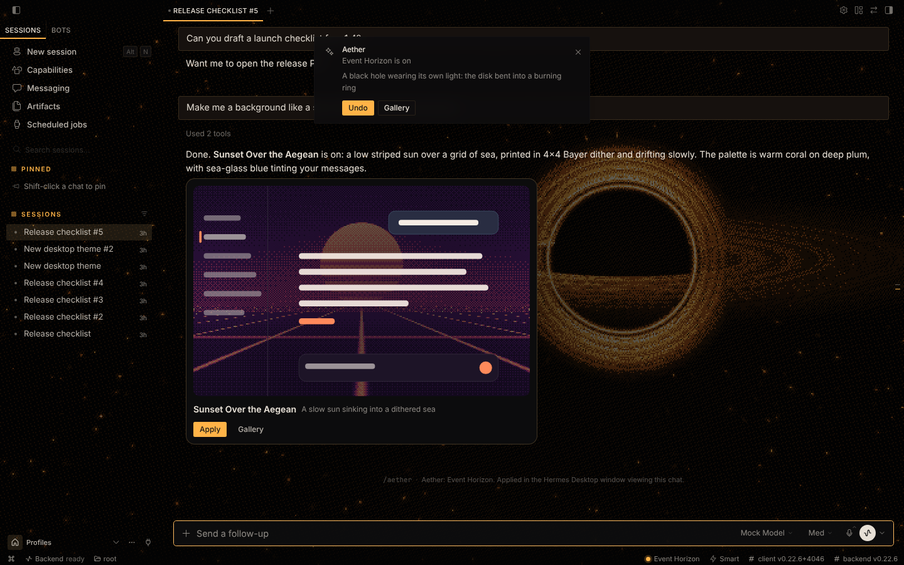
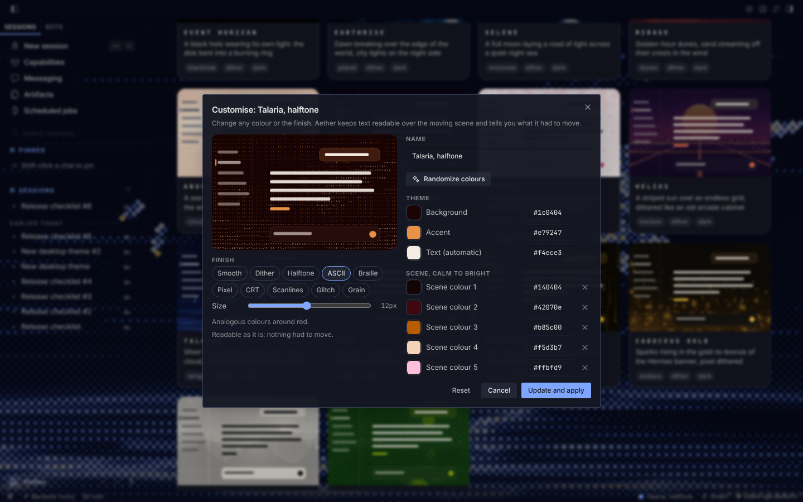
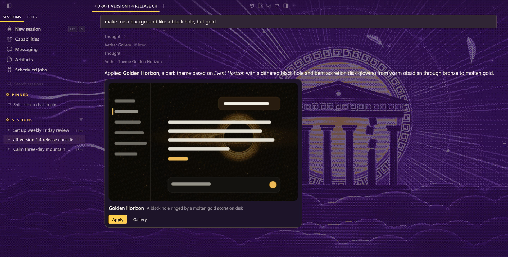
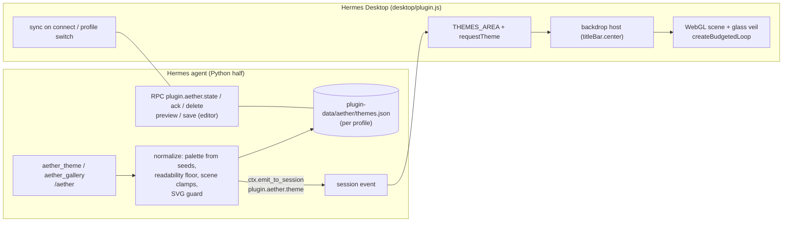

<p align="center">
  
</p>

<h1 align="center">
  
</h1>

<p align="center">
  <b>Living themes for Hermes Desktop.</b><br>
  Describe any world and Hermes paints it behind your chats: a full palette and a moving scene, with Undo.<br>
  Eighteen scenes, ten finishes, a colour editor, Randomize, and motion that reacts to your pointer.
</p>

<p align="center">
  <a href="LICENSE"></a>
  <a href="#install"></a>
  <a href="#how-it-works"></a>
  <a href="#how-it-works"></a>
  <a href="#the-scenes"></a>
  <a href="https://github.com/abundantbeing"></a>
</p>

<p align="center">
  <a href="https://github.com/abundantbeing/aether/releases/download/v0.1.0/aether-launch.mp4"></a><br>
  <sub>From the launch film, recorded in real Hermes Desktop with a real model answering. Click for the full film with sound.</sub>
</p>

**Living themes for Hermes Desktop.** Tell Hermes the look you want ("a slow dithered sunset over the sea", "a black hole, but gold", "my terminal, amber and raining") and it paints a full palette plus an animated scene behind your chats. Or pick one of eighteen hand-tuned scenes: auroras over still lakes, dawn over the edge of the world, a neon city in the rain, a temple above the clouds in Nous blue and gold.



Screenshots show the actual plugin in Hermes Desktop on Windows, with a real model answering.

## What you get

- **Ask for any look.** Describe a mood, a place, a palette or a texture in any chat. Hermes picks the scene, the colours and the finish, calls `aether_theme`, and the window you are chatting in repaints a moment later. Ask for changes the same way ("slower", "more violet", "less busy").
- **Eighteen scenes worth looking at.** Landscapes, skies, space, a city and the Hermes brand itself, each animated, most of them dithered.
- **Twenty-four scene engines, ten finishes.** A Greek temple, wings in flight, mountains, auroras, cloud seas, moonlit water, dunes, black holes, planets, skylines, blossoms, engraved rays and more, printed smooth, dithered (Bayer 2x2, 4x4, 8x8 or blue noise, down to one bit), as halftone dots, in ascii, in braille, with film grain, scanlines, a full CRT (phosphor mask, colour fringing, curved glass), occasional glitch bursts, or as chunky pixels.
- **Make any theme yours.** Open any preset or saved theme in the editor and change its colours, put any of the ten finishes on it, or press **Randomize colours** for a new palette that follows colour theory and keeps the theme's light and dark.
- **Your other themes, in one place.** Theme plugins you already have from other creators show in the gallery under **From other creators**, with the creator's name and their own picture. One click switches to one, and its creator's scene and styles run exactly as they made them. You can also give any of them a new accent, the way Hermes recolours any theme: only buttons, links and highlights change, and the recolour stays on your computer as "by its creator, recoloured by you".
- **It reacts to you.** While your pointer moves, the scene responds in a way that suits it: bending like a lens under glass, rippling like water (clicks send out rings), being drawn into a gravity well, parting around the pointer, or being blown along by it. Auto picks one per scene (water ripples, the black hole pulls, petals, sparks and falling characters are pushed aside, wings, clouds and dunes are blown, everything else bends), or you choose one. Every effect fades when you stop to read, and none adds more light than the scene's own brightest colour. Switching themes dissolves one scene into the next.
- **Text stays readable, always.** Every theme is held to a floor: body text 7:1 on its background, secondary text 4.5:1, accents 3:1, and body text 4.5:1 over the brightest part of the moving scene once the glass veil is laid over it. When a request would break that, Aether moves the colour (hue kept) or thickens the veil and says exactly what it changed.
- **Your call on intensity.** Scene strength is Balanced by default (the readability floor), Vivid when you want the scene first, Calm for long reading sessions.
- **A real theme, not a wallpaper.** Each Aether theme registers with Hermes Desktop like a built-in: it shows in Settings, Appearance, the theme picker and `/skin`, it is remembered per profile, and picking any other theme removes the scene.
- **Undo, everywhere it changed.** A short notice with Undo when Hermes or `/aether` changes your theme, and a live preview card with Undo right in the conversation that made it.
- **Motion that sleeps.** Scenes pause while Hermes is hidden or minimised, hold still when your system asks for reduced motion, and offer Full, Calm and Still plus a Battery, Balanced or High quality setting.

## The scenes



| Scene | What it is |
|---|---|
| Olympus | A temple above the clouds, its roof lifted on the light of an engraved sun, in Nous blue (#0000F2) and gold |
| Cyanotype | Nous blue ink stippled through paper, drifting like a print still developing |
| Aether | Northern lights pouring over a mountain lake, mirrored in still water |
| Alpenglow | Ranges fading into a violet dusk, valley fog drifting between them |
| Event Horizon | A black hole wearing its own light: the disk bent into a burning ring |
| Earthrise | Dawn breaking over the edge of the world, city lights on the night side |
| Selene | A full moon laying a road of light across a quiet night sea |
| Mirage | Golden-hour dunes, sand streaming off their crests |
| Above the Clouds | A sea of cloud at first light, seen from the window seat |
| After Hours | A neon city in the rain, its windows doubled in the wet street |
| Hanami | Cherry boughs overhead and petals drifting down through spring light |
| Helios | A striped sun over an endless grid, dithered like an old arcade cabinet |
| Talaria | Silver wings at full speed over a sea of cloud, feathers torn loose by the wind |
| Styx | Dark river contours drifting slowly |
| Phosphor | The classic Hermes amber terminal, raining in text characters |
| Caduceus Gold | Sparks rising in the gold-to-bronze of the Hermes banner |
| Folio | Mountains in one-bit ink on paper, like a page from a field journal |
| Pocket | A moonlit sea in four shades of handheld green |

### It moves when you do



### The gallery

Open it from the command palette (Aether: Open theme gallery), the status-bar chip, or Settings, Plugins, Aether. Every card is a live preview of the theme with a small mock of the app painted in its colours; hover to animate. The box at the top hands your description to Hermes in a fresh chat.



### Balanced and Vivid


## Install

You need Hermes 0.23.1 or newer with Hermes Desktop (or the Webapp).

```bash
hermes plugins install abundantbeing/aether --enable
```

Then, in Hermes Desktop:

1. Open **Capabilities, Plugins** and select **Aether**.
2. Confirm **Agent** is enabled. This gives Hermes the theme tools, the `/aether` command and the design skill.
3. Enable **Desktop**. This adds the scenes, the gallery, the status chip and the settings page. The Desktop half is opt-in.
4. Ask Hermes for a theme, or run **Aether: Open theme gallery** from the command palette.

Use the same Hermes profile for installation and Desktop. No API keys or extra services are needed.

## Using it

- **Ask in any chat.** "Make me a background like rainy Tokyo at night", "something calm for late-night coding", "Selene, but in gold". Hermes finds `aether_theme` through tool search and calls it.
- **Slash command.** `/aether` opens a picker, `/aether event horizon` applies one, `/aether off` returns to your previous theme, `/aether list` lists everything.
- **From another app.** Ask from Telegram or the CLI and the theme is saved; Hermes Desktop applies it the next time it connects to that profile.
- **The status chip.** While a scene is on, the status bar shows its name. Click it for motion, scene strength, the gallery, Off and all of Aether's settings.
- **Settings, one click away.** The **Settings** button at the top of the gallery opens Settings, Plugins, Aether directly.
- **Settings, Plugins, Aether.** Motion, scene strength, reduced motion, pointer reaction (Auto, Lens, Ripples, Gravity well, Repel, Wind or Off), pausing in the background, quality, and whether theme changes are announced.



### Customising a theme

Every card in the gallery has a **Customise** button (so does the status chip, for the theme that is on). It opens an editor with a live preview of the scene and three ways to change it:

- **Colours.** The theme's background, accent, text and 2 to 5 scene colours, each with a picker and a hex field.
- **Finish.** Any of the ten finishes on any scene: Smooth, Dither, Halftone, ASCII, Braille, Pixel, CRT, Scanlines, Glitch or Grain, with a size slider for the finishes made of cells or dots and the four dither patterns. Olympus in braille, Talaria in halftone, Event Horizon on a CRT: every pairing works.
- **Randomize colours.** A new palette from one colour harmony (analogous, complementary, split complementary, triadic or monochrome) around a random hue. Each colour keeps its lightness and vividness, so the dark stays dark, the highlight stays bright, and the result still feels like the theme it came from. Hues are chosen where the screen can show them at full strength, so a vivid colour never turns muddy. Each roll starts from the theme as you opened it, and the editor names the harmony it used.

As you change anything, Aether checks readability exactly as it does for Hermes's themes and says in plain words what it had to move, for example an accent lightened so it stays visible or the glass thickened for a busier finish. **Save and apply** keeps the result for this profile: a preset becomes "Selene (custom)" next to the original (or "Talaria, halftone" when only the finish changed), and a theme of your own is updated in place. You can also just ask: "Selene, but gold" or "Talaria, but halftone" starts from that theme and changes only what you name. Saving needs the Agent half; without it the editor is read-only.





## How it works



A theme reaches the Desktop window that is viewing the chat through a session event, so asking in one window never repaints another window on a different profile. When nobody is viewing (the request came from a messaging app), the theme waits in a pending slot that the next Desktop to connect applies once.

Every scene is a fixed shader that ships with the plugin; the agent only chooses parameters. A hand-written SVG scene is checked on the agent side (no script, no foreign content, no external references, no event attributes) and is only ever shown as an image, where the browser runs no script and fetches nothing.

## Privacy and disclosure

- **No network calls of its own, no telemetry, no credentials.** The Desktop half talks only to your configured Hermes backend through the plugin SDK.
- **Fonts.** A theme may pick one of five UI fonts. Choosing Inter, IBM Plex Sans, Space Grotesk or Courier Prime loads that font from Google Fonts through Hermes Desktop's own theme typography, the same way Hermes's built-in themes load Courier Prime. JetBrains Mono ships with the app. The default keeps your current font and loads nothing.
- **Pointer.** With pointer reaction on, the Desktop half listens to pointer movement inside the Hermes window, and to clicks when the mode uses them (Ripples and Repel, not at Battery quality), to move the scene. The listeners are passive and never block or change a click. Nothing is recorded or sent anywhere, and clicks are kept only as a position and a time for about two seconds.
- **Other creators' themes.** To show who made each theme the gallery does not recognise, the agent half reads the installed plugins of the active profile (`<hermes home>/plugins`): each one's `plugin.yaml` (name, author), its Desktop script (to see which themes it registers) and one picture from inside its own folder (its catalog banner or first README image). It reads nothing else, writes nothing, and sends nothing anywhere. Switching to one of those themes asks Hermes for it by name; Aether never copies or changes another plugin.
- **Stored data:** themes Hermes made, in `<hermes home>/plugin-data/aether/themes.json` for each profile. Desktop preferences (motion, strength, quality), a cache of seen themes and your recolours of other creators' themes are in the app's own plugin storage on your machine.
- **Desktop surface:** only the documented SDK (`ctx.register`, `ctx.registerSettingsPage`, `ctx.onEvent`, `ctx.storage`, `ctx.setTimeout`, `ctx.addEventListener`, `host.request`, `host.composer`, `host.notify`, `requestTheme`, `useTheme` (including its theme list and palette preview), `setAccentOverride` (the live recolour preview, cleared when the dialog closes), `os.openExternal` (a creator's page), `createBudgetedLoop`, `DecodeText`, `Dialog` and `Input` (the editors), the `titleBar.center` and `statusBar.right` slots, `THEMES_AREA`, `TRANSCRIPT_DIRECTIVE_AREA`). While a scene is on, it adds one fixed layer behind the window and one style tag that applies Desktop's own Window Glass transparent-surface rules under its own `data-aether-backdrop` attribute. The app shell is found only through `[data-contrib-shell]`, the documented window-glass hook; no app-internal markup is named. Turning the theme off or disabling the plugin removes all three.
- **No tools beyond its own two, no hooks, no shell commands, no background processes, no self-update, no binaries, no third-party code.**

## Compatibility and known limits

- Needs Hermes 0.23.1 or newer (session events and plugin RPC). The Desktop half feature-detects newer SDK pieces.
- Scenes need WebGL. Without it, a theme falls back to a still gradient of its colours.
- A plugin theme registers when the Desktop half loads, so the very first frame of a cold start paints your previous palette for a moment.
- Runtime-verified in native Hermes Desktop on Windows 11 (GPU WebGL) and in the Hermes Webapp on Linux (software WebGL). macOS uses the same renderer and SDK but has not been runtime-verified yet.
- At Vivid strength, text that crosses the brightest part of a scene can fall below the readability floor. Balanced always holds it.
- A main-branch checkout of Hermes reports the last tag on its own branch (0.22.x), so the loader skips plugins that require 0.23.x there. Install on a release, or lower `requires_hermes` in your local copy.

## Development

The Desktop half is written in `desktop-src/` and bundled with esbuild into `desktop/plugin.js`, which is what Hermes loads and what reviewers read. The presets are defined once in `_presets.py`; `scripts/gen_presets.py` writes them, normalized by the same code the agent uses, into the Desktop bundle.

```bash
npm install
npm run build                 # presets + desktop/plugin.js
npm run check                 # presets in sync, colour harmonies, house lint, every shader compiles and paints

# Python: contract tests (including 300 fuzzed themes) and end-to-end tests through Hermes's real
# plugin discovery
cd tests && python -m pytest -q

# Catalog admission check, in a scratch HERMES_HOME
hermes plugins validate .
```

`tests/shaders.mjs` compiles every engine and finish pair (240 programs) in headless Chromium and checks each paints more than one colour. It also paints every pointer mode on every engine and checks the frame changes while the pointer moves, is identical to the untouched scene at rest, and never goes brighter than the scene's top colour. `tests/harmony.mjs` rolls Randomize 150 times on every preset and checks each roll keeps the theme's lightness, stays on its harmony's hues and keeps vivid colours vivid. `tests/render_presets.mjs` and `tests/render_scenes.mjs` render presets or any scene spec to PNG for art direction.

`tests/render_frames.mjs` renders any preset (or `all` of them, or a scene spec) as a frame-exact PNG sequence for video, up to 4K, with optional finish override, glass veil and a scripted pointer sweep (`--pointer sweep`, with `--interaction auto|lens|ripples|well|repel|wind|off`, `--clicks 0.5,1.2` for scripted clicks in seconds, and `--move` / `--hold` to stop the pointer and watch the effect relax):

```bash
node tests/render_frames.mjs "Event Horizon" out --width 3840 --height 2160 --scale 2 --fps 60 --seconds 10 --pointer sweep
node tests/render_frames.mjs Selene out --pointer sweep --interaction ripples --clicks 0.5,1.2 --move 1 --hold 0 --seconds 3
ffmpeg -framerate 60 -i out/event-horizon/%05d.png -c:v libx264 -crf 12 -preset slow -pix_fmt yuv420p event-horizon.mp4
```

MIT licence, see [LICENSE](LICENSE). Aether is an unofficial community plugin.
